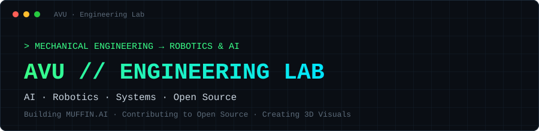
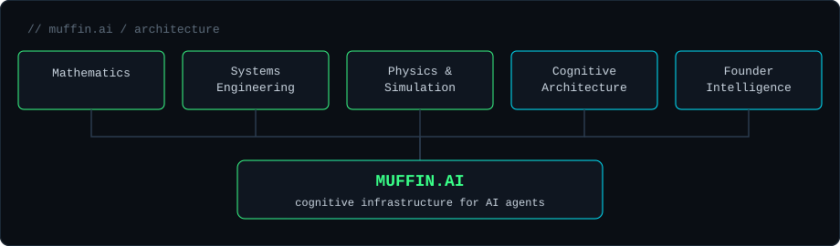

<div align="center">



**Mechanical Engineering student building toward AI, Robotics and Systems Engineering.**
*I learn by building, document the journey, and contribute to open source.*

[](https://github.com/yashvardhansingh442-dev)
[](https://leetcode.com/Yash04_09)
[](https://behance.net/avusingh)
[](mailto:yashvardhansingh442@gmail.com)

</div>

---

## 📌 About Me

I'm a final-year Mechanical Engineering student at **ABES Engineering College (AKTU)**, based in **Noida, India**. My focus is the intersection of **Artificial Intelligence**, **Robotics** and **Systems Engineering**: understanding the physics and math of a system well enough to build it from scratch, in code and in CAD.

```bash
avu@terminal:~$ whoami
> Mechanical Engineering student · Python / C++ · Robotics & AI · 3D artist
```

I'm currently open to **remote internships** in AI, robotics, Python and systems work, as well as 3D visualization and animation projects.

---

## ⚡ At a Glance

| | |
| --- | --- |
| **Focus** | Mechanical Engineering → Robotics & AI |
| **Building** | [**MUFFIN.AI**](#-muffinai-architecture), cognitive infrastructure for AI agents |
| **Contributing** | Open source (first PR merged into [Xenon](https://github.com/xianyu-sheng/Xenon)) |
| **Practicing** | Python · C++ · DSA · linear algebra from scratch |
| **Creating** | 3D visuals & animation |
| **Education** | B.Tech Mechanical Engineering, ABES Engineering College, AKTU |

---

## 🚀 Featured Builds

| Build | What it is |
| --- | --- |
| 🧁 **MUFFIN.AI** | Cognitive infrastructure for AI agents (*"AWS for AI minds"*), organized around five core pillars. Currently in active development. |
| 🔧 **Xenon** | First open-source contribution. Solved [issue #85](https://github.com/xianyu-sheng/Xenon/issues/85) (learning routing preferences from user overrides). [PR #134](https://github.com/xianyu-sheng/Xenon/pull/134) merged. |
| 🔬 **Ultrasonic Testing Prototype** | Final-year major project on non-destructive testing: using ultrasonic waves to detect internal flaws in materials without damaging them. Built with a team of four. |
| 🎨 **3D Lab** | Freelance 3D modeling, high-fidelity animation and renders, featured on [Behance](https://behance.net/avusingh) and Fiverr. |

### 📂 Selected Repositories

| Repository | Description |
| --- | --- |
| [`linear-algebra-playground`](https://github.com/yashvardhansingh442-dev/linear-algebra-playground) | Core linear algebra operations implemented from scratch in Python/NumPy, following Gilbert Strang's MIT 18.06 course. |
| [`python-deep-dive`](https://github.com/yashvardhansingh442-dev/python-deep-dive) | Structured deep dive into Python: language internals, advanced features and applied depth. |
| [`LEETCODE_DSA`](https://github.com/yashvardhansingh442-dev/LEETCODE_DSA) | DSA problems solved in Python/C++, tracking patterns, approaches and progress as part of daily practice. |
| [`Git-Demo`](https://github.com/yashvardhansingh442-dev/Git-Demo) | "Git Mastery": ten hands-on Git & GitHub workflow topics. |

---

## 🧠 MUFFIN.AI Architecture



---

## 🛠️ Tech Stack

**Daily drivers**


**Also worked with**


---

## 🎯 Currently Building

- [x] **First open-source PR merged**: [Xenon #134](https://github.com/xianyu-sheng/Xenon/pull/134)
- [ ] **MUFFIN.AI**: turning the five-pillar architecture into functional core code
- [ ] **Core engineering**: deepening C++ and Python fundamentals through systems projects
- [ ] **DSA**: daily problem solving on [LeetCode](https://leetcode.com/Yash04_09)
- [ ] **Open source**: scoping the next target project and issue

---

## 🌐 Connect

| Platform | Best for |
| --- | --- |
| [**GitHub**](https://github.com/yashvardhansingh442-dev) | Open-source work, code repositories, systems projects |
| [**Behance**](https://behance.net/avusingh) | 3D design, visual modeling, animation portfolio |
| [**LeetCode**](https://leetcode.com/Yash04_09) | DSA problem solving and algorithmic progress |
| [**Email**](mailto:yashvardhansingh442@gmail.com) | AI/robotics collaboration and 3D freelance inquiries |

---

<div align="center">

*"Build in public. Ship small, ship often."*

</div>
