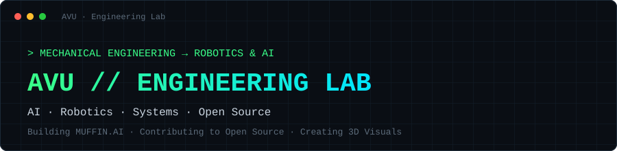
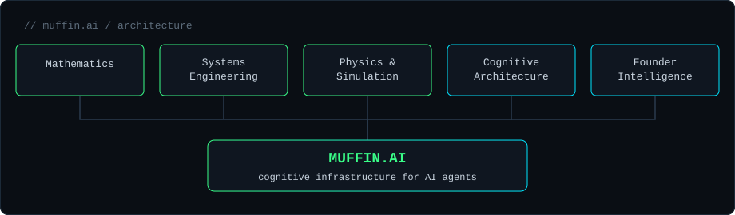

**Mechanical Engineering student building toward AI, Robotics and Systems Engineering.**
*I learn by building, document the journey, and contribute to open source.*

---

## 📌 About Me

I'm a final-year Mechanical Engineering student at **ABES Engineering College (AKTU)**, based in **Noida, India**. My focus is the intersection of **Artificial Intelligence**, **Robotics** and **Systems Engineering**: understanding the physics and math of a system well enough to build it from scratch, in code and in CAD.

My long-term goal is to build a humanoid robotics and AGI-focused company. Right now that means three things: shipping small, tested Python projects ([MUFFIN](https://github.com/yashvardhansingh442-dev/MUFFIN), [ALGEBRA-](https://github.com/yashvardhansingh442-dev/ALGEBRA-)), building the math foundation behind them, and practicing competitive programming.

I'm currently open to **remote internships** in AI, robotics, Python and systems work, as well as 3D visualization and animation projects.

---

## ⚡ At a Glance

| | |
| --- | --- |
| **Focus** | Mechanical Engineering → Robotics & AI |
| **Building** | [**MUFFIN**](https://github.com/yashvardhansingh442-dev/MUFFIN), a safety-and-memory runtime for AI agents (early prototype) |
| **Contributing** | Open source (first PR merged into [Xenon](https://github.com/xianyu-sheng/Xenon)) |
| **Learning** | Linear algebra (Strang), calculus (Thomas), algebra from scratch in code |
| **Practicing** | Python · C++ · DSA on LeetCode · competitive programming on Codeforces |
| **Creating** | 3D visuals, animation and Blender tools |
| **Education** | B.Tech Mechanical Engineering, ABES Engineering College, AKTU |

---

## 🚀 Featured Builds

| Build | What it is |
| --- | --- |
| 🧁 **[MUFFIN](https://github.com/yashvardhansingh442-dev/MUFFIN)** | A small Python library that sits between an AI agent and the real world: the agent can only *ask* to act, and MUFFIN checks the rules, allows or blocks each request, and keeps a record. Zero runtime dependencies, tested with CI. Early-stage prototype; the larger platform is a design goal, not shipped. |
| 🧮 **[ALGEBRA-](https://github.com/yashvardhansingh442-dev/ALGEBRA-)** | A free algebra curriculum (6 modules), a practice-problem generator with exact answer checking, and a CLI. Standard library only, tested with CI. The first module of the math pillar behind my long-term project. |
| 🔧 **[Xenon](https://github.com/xianyu-sheng/Xenon)** | First open-source contribution. Solved [issue #85](https://github.com/xianyu-sheng/Xenon/issues/85) (learning routing preferences from user overrides). [PR #134](https://github.com/xianyu-sheng/Xenon/pull/134) merged. |
| 🔬 **Ultrasonic Testing Prototype** | Final-year major project on non-destructive testing: using ultrasonic waves to detect internal flaws in materials without damaging them. Built with a team of four (Arduino-based). |
| 🎨 **[3D Portfolio](https://github.com/yashvardhansingh442-dev/3D-PORTFOLIO)** | Blender projects, product renders and the Python tools I write for them, such as a droplet generator that scatters water droplets over any mesh. Freelance work on [Behance](https://behance.net/avusingh) and Fiverr. |

### 📂 Selected Repositories

| Repository | Description |
| --- | --- |
| [`MUFFIN`](https://github.com/yashvardhansingh442-dev/MUFFIN) | Safety-and-memory runtime for AI agents. Rule checks, allow/block decisions and an audit record. |
| [`ALGEBRA-`](https://github.com/yashvardhansingh442-dev/ALGEBRA-) | Algebra curriculum, exact-checking practice generator and CLI. Zero runtime dependencies. |
| [`linear-algebra-playground`](https://github.com/yashvardhansingh442-dev/linear-algebra-playground) | Core linear algebra operations implemented from scratch in Python/NumPy, following Gilbert Strang's MIT 18.06 course. |
| [`python-deep-dive`](https://github.com/yashvardhansingh442-dev/python-deep-dive) | Structured deep dive into Python: language internals, advanced features and applied depth. |
| [`LEETCODE_DSA`](https://github.com/yashvardhansingh442-dev/LEETCODE_DSA) | DSA problems solved in Python/C++, tracking patterns, approaches and progress. |
| [`CODEFORCES_CP`](https://github.com/yashvardhansingh442-dev/CODEFORCES_CP) | Public log of my Codeforces journey in Python: solutions with the key idea in each header, plus an upsolve log of contest misses. |
| [`3D-PORTFOLIO`](https://github.com/yashvardhansingh442-dev/3D-PORTFOLIO) | Blender projects, reusable Python tools and process breakdowns. |
| [`Git-Demo`](https://github.com/yashvardhansingh442-dev/Git-Demo) | "Git Mastery": ten hands-on Git & GitHub workflow topics. |

---

## 🧠 The Bigger Picture

Each pillar is learned by building. The rule I follow: I don't move to the next topic until the current one is implemented in code. Algebra comes first, and [ALGEBRA-](https://github.com/yashvardhansingh442-dev/ALGEBRA-) is that first module.

---

## 🛠️ Tech Stack

**Daily drivers**

**Also worked with**

---

## 🎯 Currently Building

- [x] **First open-source PR merged**: [Xenon #134](https://github.com/xianyu-sheng/Xenon/pull/134)
- [x] **MUFFIN v0.1**: tested safety-and-memory runtime prototype for AI agents
- [ ] **ALGEBRA-**: building the exact symbolic engine (planned) on top of the finished curriculum and generator
- [ ] **Math foundation**: working through Strang's *Linear Algebra* and Thomas' *Calculus*, with code for each topic
- [ ] **Competitive programming**: Codeforces in Python, moving to C++, with every miss logged and upsolved
- [ ] **DSA**: daily problem solving on [LeetCode](https://leetcode.com/Yash04_09)
- [ ] **Blender tools**: turning the droplet generator into an add-on that works on any surface
- [ ] **Open source**: scoping the next target project and issue

---

## 🌐 Connect

| Platform | Best for |
| --- | --- |
| [**GitHub**](https://github.com/yashvardhansingh442-dev) | Open-source work, code repositories, systems projects |
| [**Behance**](https://behance.net/avusingh) | 3D design, visual modeling, animation portfolio |
| [**LeetCode**](https://leetcode.com/Yash04_09) | DSA problem solving and algorithmic progress |
| [**Codeforces**](https://codeforces.com/profile/yashvardhansingh442) | Competitive programming progress |
| [**Email**](mailto:yashvardhansingh442@gmail.com) | AI/robotics collaboration and 3D freelance inquiries |

---

*"Build in public. Ship small, ship often."*

